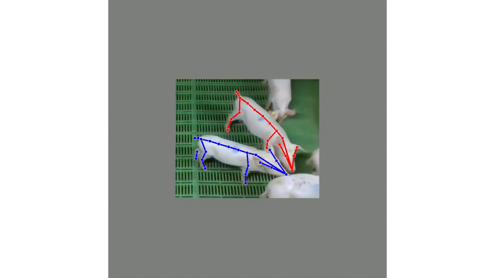
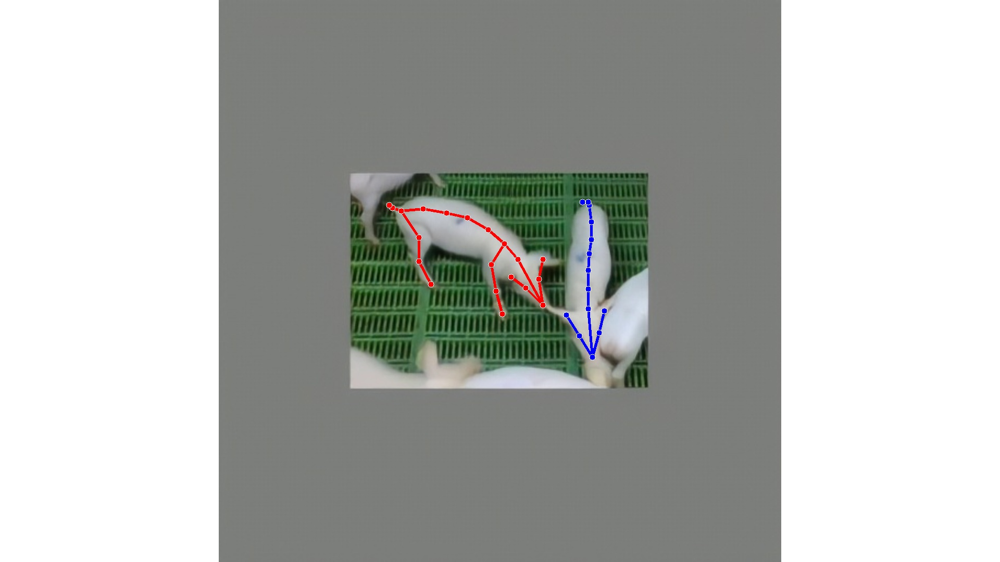
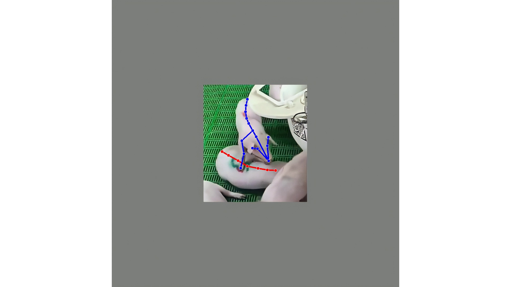
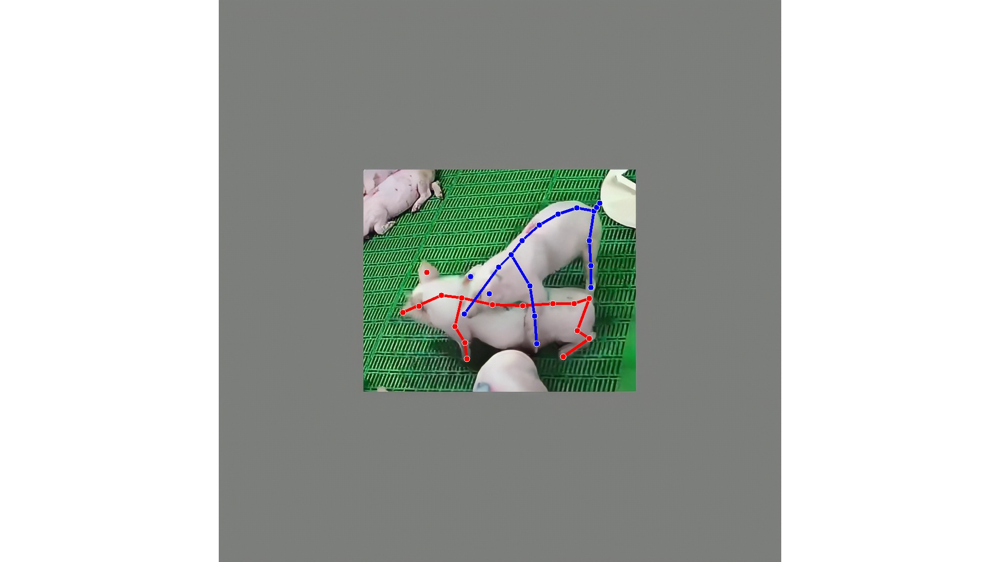
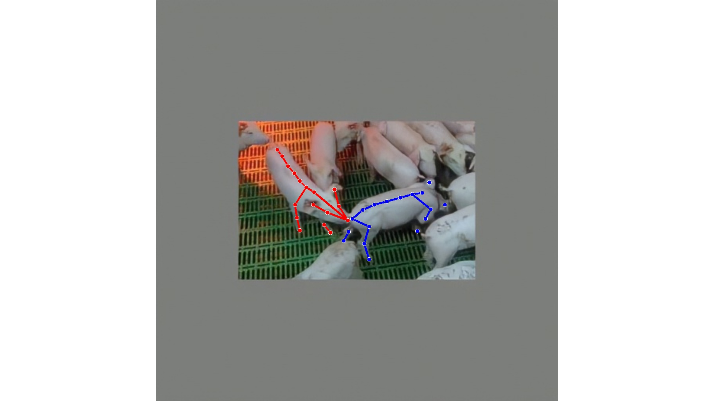
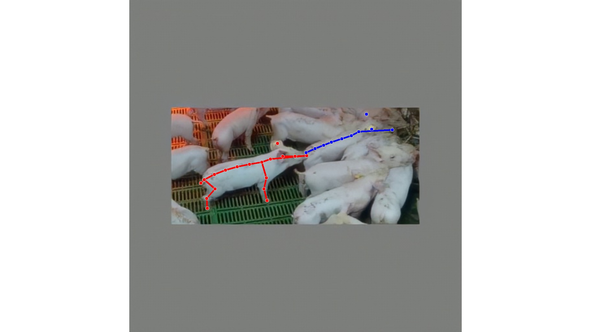
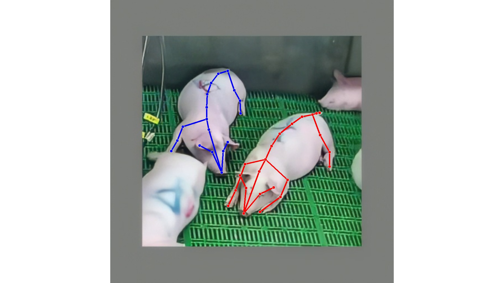
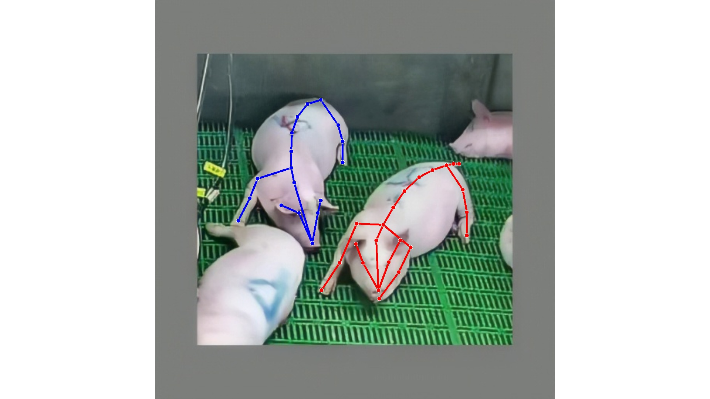
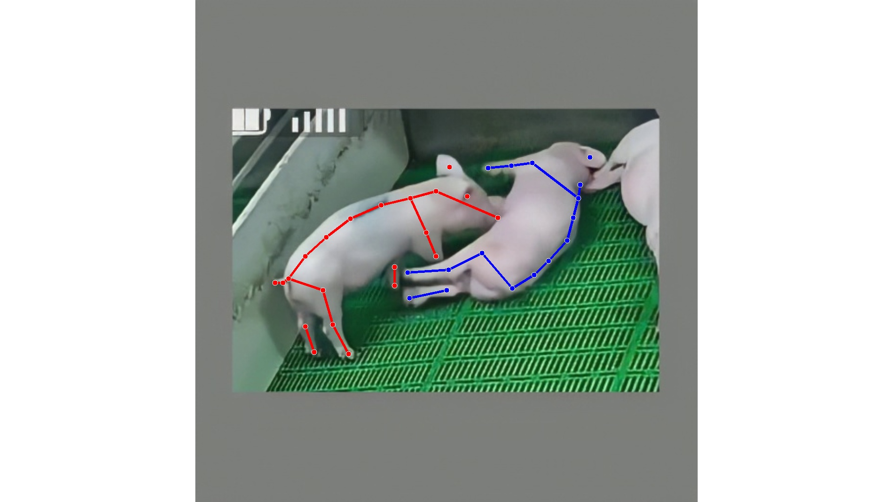
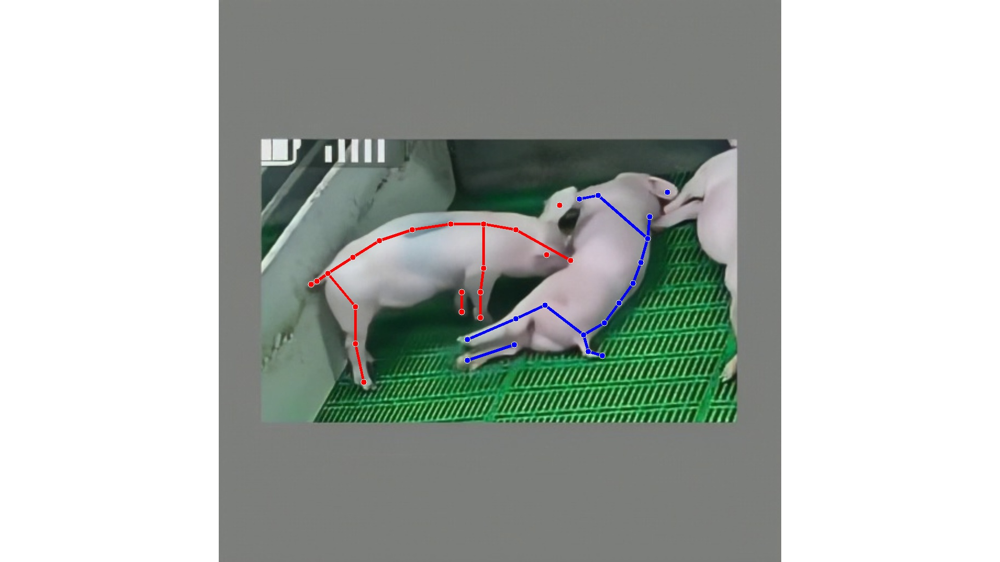

# Language-Guided Interacting Body-Part Relation Reasoning for Pig Social Behavior Recognition

The full dataset and code will be made publicly available upon publication of the paper. This preview includes annotated example frames and an outline of the reproduction workflow.

Language-Guided Sparse Relation Querying (LGSRQ) recognizes social behavior from the skeletons of two pigs. It uses short text descriptions to specify which body-part relations to examine, such as whether one pig's head stays close to the other pig's tail.

## Dataset

The benchmark contains **500 clips** comprising **16,028 annotated frames** from **14 recording scenes**. For each clip, we select two target pigs in the source video and crop the frame sequence around them. We annotate 26 two-dimensional keypoints per pig in the cropped frames and track each pig's identity throughout the clip. Each clip has one behavior label.

The [`dataset/`](dataset/) directory contains one example clip per class. The two images in each row show an earlier and a later frame from the same clip. Red and blue skeletons distinguish the two pigs. Open a sequence to browse all its frames in order.

| Behavior | Earlier frame | Later frame | Example sequence |
| --- | --- | --- | --- |
| Fighting |  |  | [60 frames](dataset/fighting/e_11/) |
| Mounting |  |  | [54 frames](dataset/mount/h_8/) |
| Tail biting |  |  | [36 frames](dataset/tailbite/a_1/) |
| No interaction |  |  | [55 frames](dataset/no_interaction/e_9/) |
| Social contact |  |  | [41 frames](dataset/social_contact/f_5/) |

<details>
<summary><strong>26 keypoints and their seven body-part groups</strong></summary>

Both pigs use the same layout. Numbers are the zero-based indices in the pose annotations.

| Body part | Keypoints (index and annotation name) |
| --- | --- |
| Head and face | 0 `nose`, 1 `left_ear`, 2 `right_ear`, 3 `left_eye`, 4 `right_eye` |
| Neck and shoulders | 5 `left_shoulder`, 6 `right_shoulder`, 17 `neck`, 18 `shoulder` |
| Front legs | 7 `left_elbow`, 8 `right_elbow`, 9 `left_paw`, 10 `right_paw` |
| Trunk | 19 `end_shoulder`, 20 `mid_belly` |
| Hip | 11 `left_hip`, 12 `right_hip`, 21 `front_hip`, 22 `mid_hip` |
| Hind legs | 13 `left_knee`, 14 `right_knee`, 15 `left_foot`, 16 `right_foot` |
| Tail | 23 `tail`, 24 `tail_middle`, 25 `tail_end` |

</details>

## How to use

### Clone

```bash
git clone https://github.com/linwjscau/Language-Guided_Skeleton-based_Pig_Social_Behavior_Recognition.git
cd Language-Guided_Skeleton-based_Pig_Social_Behavior_Recognition
```

### Dependencies

LGSRQ uses Python, PyTorch, MMAction2, and OpenCLIP. The full release will include the environment specification and training configurations.

### Preprocessing

1. Match each cropped frame to its keypoint annotation in LabelMe-style JSON. Order frames by time and keep a consistent identity for each pig within the clip.
2. For behavior recognition, pack the two pigs' keypoints, visibility scores, and clip label into MMAction2 pose annotations in PKL format. The same frame annotations can also be exported to COCO keypoint format for pose estimation.
3. Use the three fixed folds. Each recording scene appears in the test set of exactly one fold. Training and validation clips for that fold come from the remaining scenes.
4. Encode each body-part relation description once with the frozen OpenCLIP text encoder. Save the resulting embeddings and reuse them as fixed queries during training and evaluation.

### Training and evaluation

For each fold, train LGSRQ with the corresponding configuration using MMAction2's `tools/train.py`. Select the checkpoint with the highest validation Macro-F1 and evaluate it on that fold's held-out test clips. Pool the predictions from all three folds and compute accuracy and Macro-F1 over the 500 clips.
